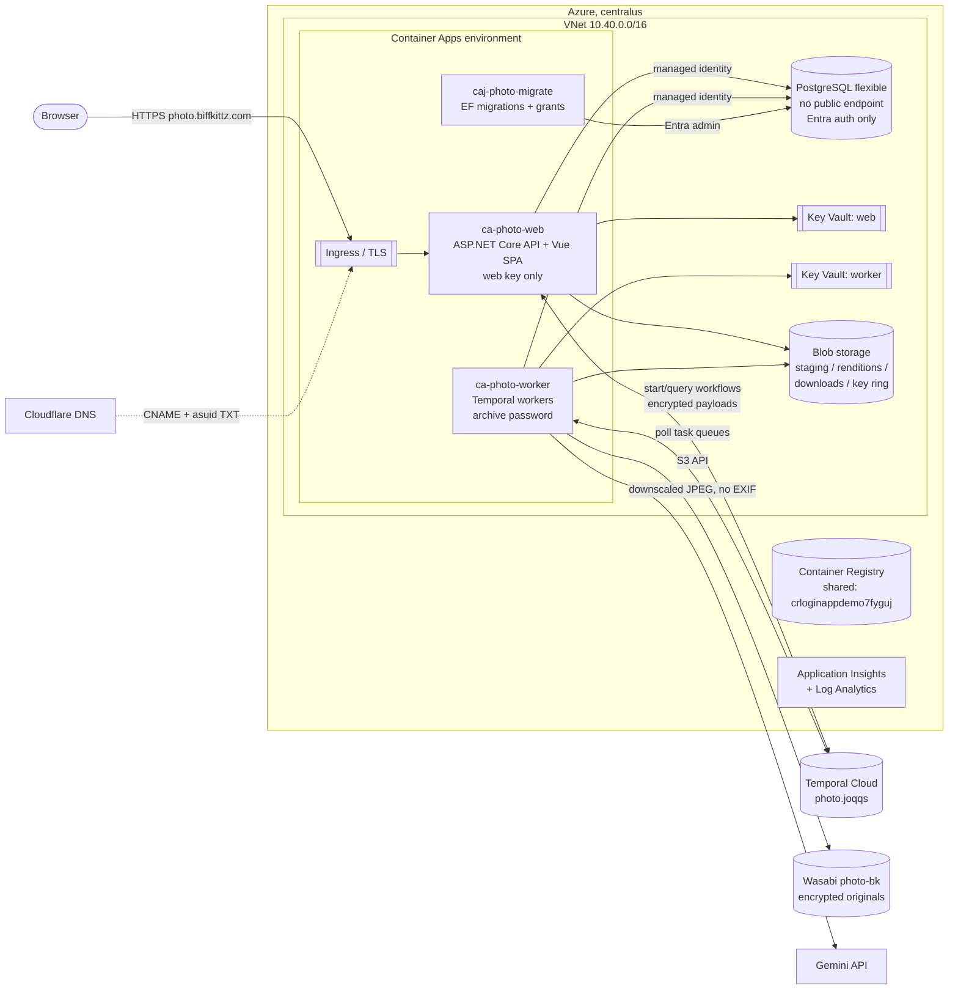
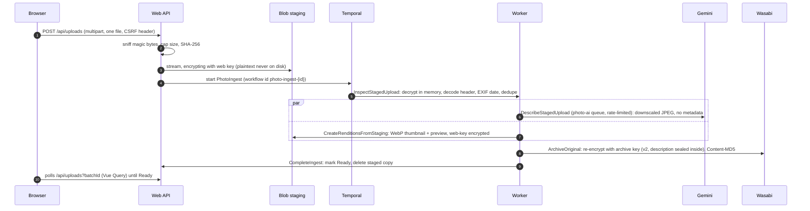

# Architecture

Photo Manager is a private photo library for a family archive that already lives, encrypted, in the Wasabi
bucket `photo-bk` (written over the years by `protect.ps1`). The app lets the family browse, search, download
and upload photos, find them by year and month, and gather them into shared albums: admins sign in with allowlisted GitHub accounts, and family members, invited from the app's
People page, with Google. Every photo stays encrypted at rest; new uploads get an AI description (Gemini)
before they are encrypted into the archive.

## Components



| Component | Technology | Responsibility |
|---|---|---|
| Web (`ca-photo-web`) | ASP.NET Core 11, Kestrel :8080, Vue 3 SPA in `wwwroot` | GitHub and Google sign-in, invites, gallery/search/timeline and album API, streams renditions and prepared downloads (decrypting with the **web key**), stages uploads, starts workflows |
| Worker (`ca-photo-worker`) | .NET 11, Temporal .NET SDK | All archive cryptography, Gemini calls, renditions, indexing, downloads. No public ingress |
| Migrator (`caj-photo-migrate`) | .NET 11 console, Container Apps Job | Applies EF Core migrations and least-privilege PostgreSQL grants inside the VNet |
| PostgreSQL | Azure Database for PostgreSQL flexible server | Photo metadata, albums, jobs, downloads, audit log. No photo bytes |
| Blob storage | Azure Storage (private endpoint, Entra-only) | Web-key-encrypted staging uploads, renditions, prepared downloads; Data Protection key ring |
| Archive | Wasabi `photo-bk` (us-east-2) | Encrypted originals: legacy `protect.ps1` files and v2 files written by the app |
| Temporal Cloud | Namespace `photo.joqqs`, API-key auth | Durable orchestration of ingest, indexing, backfills, downloads |
| Gemini | Developer API, `gemini-3.8-flash` | One-line descriptions + tags for photos |

## Security model in one paragraph

The internet-facing web tier can never decrypt an archive original: only the workers (which have no ingress)
hold the archive password (`docs/adr/0001-split-keys.md`). The web tier holds a separate random **web key**
that protects what it legitimately needs to read: thumbnails/previews, staged uploads and prepared downloads.
Every secret lives in Key Vault (one vault per tier) and is read by the app's managed identity at startup;
Terraform never sees secret values. PostgreSQL, Key Vault and Blob Storage are reachable only from the VNet;
there are no database passwords or storage keys. Temporal Cloud only ever stores ciphertext (payload codec).
See [security.md](security.md) for the threat model.

## Key hierarchy

| Key | Held by | Protects | Format |
|---|---|---|---|
| Archive password (`Crypto--ArchivePassword`) | Workers only | Legacy originals (PBKDF2-SHA1 per file) and v2 originals (PBKDF2-SHA256 600k → HKDF per file) | protect.ps1 / v2 |
| Web key (`Crypto--WebKey`, 256-bit random) | Web + workers | Renditions, staged uploads, prepared downloads (HKDF per file) | v2 |
| Payload key (`Temporal--PayloadKey`, 256-bit) | Web + workers | Every Temporal payload and failure message | AES-256-GCM codec |
| Data Protection key ring | Web (wrapped by Key Vault key `dataprotection`) | Session, OAuth correlation and antiforgery cookies | ASP.NET Core |

Details and file formats: [encryption.md](encryption.md).

## Data flows

### Upload (ingest)



The description is generated **before** archive encryption because it is sealed into the encrypted file's
metadata, which makes the bucket self-describing if the database is ever lost. So ingest waits for Gemini (up to
12 minutes of retries) and, if it still fails, archives the photo without a description. Uploaders can switch
descriptions off on the Uploads page (`?describe=false`, remembered per browser): ingest then skips Gemini and
leaves the photo "not started", to be described later with the photo's *Describe with AI* button or **Generate
missing descriptions**. A description added later is stored in the database only, not sealed in the file.

Every AI description also renames the photo after itself (`dog_running_in_the_snow.jpg`): `photos.file_name` is
the name the library shows and downloads use, while `original_file_name`, the name the photo arrived with, never
changes and stays searchable. Names written by people do not rename photos, and the archive keeps the uploaded
name. See [ADR 0014](adr/0014-photos-named-after-their-description.md).

### Viewing

Gallery tiles load `GET /api/photos/{id}/thumbnail?v={version}` directly into ``. The API reads the
web-key-encrypted rendition from Blob Storage and decrypts it while streaming (cached `private, immutable`).
Photos indexed from the legacy archive have no renditions at first: the API answers `202 Accepted` and starts
`EnsureRenditions` (deterministic workflow id, so concurrent viewers share one execution); the SPA polls until
the rendition is ready. A rendition that turns out to be missing, corrupted or encrypted with a retired web key
is regenerated the same way. Admins can backfill everything up front from the Actions page; that backfill also
hides byte-identical copies of the same photo ([ADR 0010](adr/0010-duplicates.md)).

### Albums, the timeline and "On this day"

Albums are rows in PostgreSQL (`albums`, `album_photos`) that only the web tier reads and writes; they hold photo
ids, never bytes, and nothing in them is ever deleted (`deleted_at`, `removed_at`). Everyone signed in shares
them. The gallery's year and month buttons come from `GET /api/photos/timeline` (photo counts per month) and
narrow `GET /api/photos` with `year`/`month`; "On this day" is `GET /api/photos/on-this-day`. All three group
dates in the viewer's calendar, from the UTC offset the browser sends. Downloading an album is an ordinary
prepared download whose photo ids the API takes from the album. See [ADR 0013](adr/0013-shared-albums-and-timeline.md).

### Downloading originals

The API cannot decrypt originals. `POST /api/downloads` (selected photos, or an album) creates a request and
starts `PrepareDownload`; a
worker streams the original(s) out of Wasabi, decrypts with the archive key and re-encrypts with the web key
(a ZIP for several photos) into the `downloads` container. The SPA polls, then downloads
`/api/downloads/{id}/content`, which the API decrypts on the fly. Prepared downloads expire after a day (blob
lifecycle rule) and are visible only to their requester.

### Re-indexing the archive

`ReindexArchive` pages through the bucket 1000 keys at a time, creating records for objects added outside the
app (for example by `protect.ps1`) and stamping `last_seen_at`. It continues-as-new every 20 pages, then marks
photos not seen since the scan began as `Missing`, refusing implausible sweeps (empty listing, or more than
20% of the library). A Temporal **Schedule** runs it nightly (09:00 UTC with 30 minutes jitter).

## Temporal design

| Best practice (docs.temporal.io/best-practices) | How it is applied |
|---|---|
| Pass references, not data (2 MB payload limit) | Workflows exchange ids/keys only; bytes stay in Blob/Wasabi |
| Client-side encryption of payloads | `AesGcmPayloadCodec` + encoded failure attributes; Temporal Cloud stores ciphertext only, and unencrypted payloads are rejected |
| Idempotent activities, deterministic ids | Archive keys derive from the photo id; DB writes are upserts/state checks; workflow ids derive from domain ids |
| Always set StartToClose; bounded retries; non-retryable errors | `ActivityProfiles`: per-activity timeouts above downstream timeouts, exponential backoff, `NonRetryableErrorTypes` for permanent failures |
| Heartbeat only long activities | Downloads (per photo) and indexing pages |
| Continue-as-new for long-running work | Re-index (every 20 pages) and backfills (every batch of 25) |
| Separate task queues per workload | `photo-ingest`, `photo-interactive`, `photo-batch`, `photo-ai` (Gemini, server-side rate limit) |
| Schedules for periodic work | Nightly re-index Schedule with jitter and overlap = skip |
| Batch fan-out, avoid a child workflow per item | Backfill processes 25 ids per run with parallelism 5 |
| API keys per service, scoped to the namespace | Terraform creates namespace-scoped service accounts `photo-prod-web` / `photo-prod-worker` |
| Instrument SDK metrics | Temporal runtime metrics exported via OpenTelemetry to Application Insights |
| Graceful shutdown | `GracefulShutdownTimeout` 25 s < Container Apps termination grace 60 s |

Worker Versioning is not used in v1: workflows are short-lived or continue-as-new frequently, and the single
worker revision is replaced on deploy. Incompatible workflow changes must use `Workflow.Patched`
(see `app/backend/CLAUDE.md`). Revisit when long-running workflows are introduced.

## Repository layout

```
app/backend        .NET solution (Core, Data, Infrastructure, Api, Worker, Migrator, Cli + tests)
app/frontend       Vue 3 + TypeScript SPA
infra              Terraform: bootstrap (app and CI identities, access to the shared state and registry), modules, environments/prod
docs               This documentation and architecture decision records (docs/adr)
scripts            dev-secrets.sh, bootstrap-keyvault.sh
.github            CI, CodeQL, Terraform and deploy workflows; Dependabot
Dockerfile         web / worker / migrator images
docker-compose.yml local dependencies (and optionally the app containers)
buildAndRunSite.sh build, package and run the site locally
```
