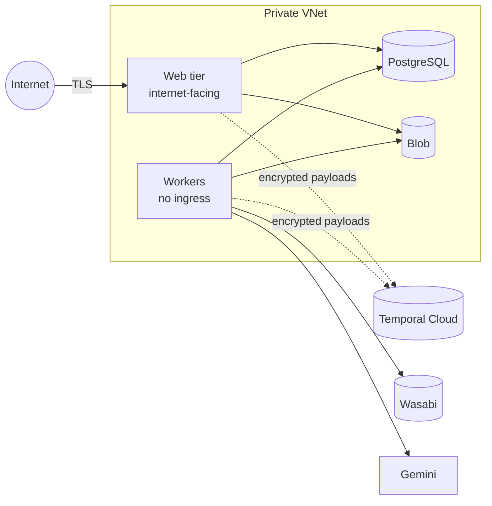

# Security

Security is the first design constraint of this app: it holds a family's private photos. This document is the
threat model, the list of controls, and the residual risks you are accepting by running it.

## Assets

| Asset | Where | Impact if exposed |
|---|---|---|
| Original photos | Wasabi `photo-bk` (encrypted) | Severe: private family photos with EXIF (GPS, dates, devices) |
| Archive password | Worker Key Vault, your password manager | Severe: decrypts the entire archive, including all `protect.ps1` history |
| Previews/thumbnails | Blob Storage (web-key encrypted) | High: downscaled photos (EXIF removed) |
| Web key | Both Key Vaults | High: decrypts previews, staged uploads and prepared downloads (originals, for up to a day) |
| Descriptions, filenames, dates | PostgreSQL; sealed in v2 archive files | Medium: reveals content of the library |
| Sessions | Browser cookies | High: the photos the user can see |
| Cloud credentials (Wasabi, Gemini, Temporal, Cloudflare, Azure) | Key Vault, GitHub environment secrets | Varies; Wasabi keys allow deleting the archive |

## Trust boundaries and threats

| Threat | Main controls |
|---|---|
| Stranger reaches the photos | GitHub sign-in with a server-side allowlist of **numeric** GitHub ids (logins can be renamed and re-registered); allowlist re-checked on every request, so removal is immediate; everything under `/api` requires a session |
| Web tier compromised (RCE, dependency) | **Split keys**: the web tier never holds the archive password or Wasabi credentials, so it cannot read or delete originals ([ADR 0001](adr/0001-split-keys.md)); least-privilege blob roles (read-only on renditions and downloads); its database role cannot delete |
| Cross-site attacks (CSRF, XSS, clickjacking) | `__Host-` HttpOnly Secure SameSite=Lax cookies; antiforgery token required in the `X-CSRF-TOKEN` header for every state-changing API call; strict CSP (`script-src 'self'`, no inline script or style, `frame-ancestors 'none'`); no `v-html` anywhere (lint rule) and all text rendered escaped |
| Session theft | HttpOnly cookies (no tokens in localStorage/sessionStorage), 8 hour sliding lifetime and a 24 hour absolute lifetime (a replayed cookie cannot be kept alive forever), Data Protection key ring wrapped by a Key Vault key; sign-out or an expired session also drops every cached photo and queued upload in the browser |
| Malicious uploads (polyglots, decompression bombs, parser bugs) | Magic-byte sniffing (JPEG/PNG/GIF/WebP only, the client-declared type is ignored); 100 MB size cap; 80 megapixel cap before decoding; managed decoder (ImageSharp, no native codecs); metadata stripped from renditions; files decrypted only on workers |
| Filename tricks (path traversal, bidi spoofing) | Filenames sanitized (control, bidi-override and invalid characters removed, client paths dropped, extension forced to the detected type); object keys never derive from filenames for new uploads; `Content-Disposition` built by the framework |
| Prompt injection through photo content | Gemini output is untrusted text: forced JSON schema, length caps, control characters stripped, rendered as plain text; the model has no tools and its output drives no decisions |
| Data sent to Gemini | Only a downscaled JPEG with all metadata removed; no filenames or user data in the prompt |
| Database exposure | No public endpoint (VNet-integrated); Entra-only authentication (no passwords exist); per-tier roles with least-privilege grants; TLS with certificate verification (`SslMode=VerifyFull`); no photo bytes stored |
| Storage/Key Vault exposure | Public network access disabled; private endpoints only; shared keys disabled (Entra RBAC only); Key Vault purge protection; audit logs to Log Analytics |
| Temporal Cloud breach | Every payload and failure message is AES-256-GCM encrypted client-side, and payloads that are not encrypted with the payload key are rejected (no plaintext inputs can be injected); workflows carry only ids; one namespace-scoped service account per tier |
| Abuse/brute force | Per-user/IP fixed-window rate limits (auth 30/min, expensive operations 30/min, uploads and upload retries 300/min, API 1200/min); the unauthenticated readiness probe reuses its database check for 5 seconds, so it cannot be used to flood the database |
| One user acting on another's data | Uploads and prepared downloads belong to the numeric GitHub id that created them (never the login, which can be renamed or re-registered); other users get 404. Only finished photos are visible or editable through the photo endpoints |
| Tampering with archive files | v2 is authenticated encryption (chunked AES-256-GCM, header bound into keys, truncation detection); legacy files have no integrity protection (see residual risks). Workers check a file's key type from its header before resolving any key, so web-key data (which the web tier can write) can never trigger an archive-password derivation |
| Supply chain | Locked restores (`packages.lock.json`, `npm ci --ignore-scripts`), NuGet/npm audit in CI, Dependabot, SHA-pinned GitHub Actions, digest-pinned base images, CodeQL, Trivy, gitleaks, SBOM + provenance on release images |
| CI/CD credential abuse | Keyless Azure access (OIDC federation); the pull-request plan identity is read-only, including the Terraform state (plans run with `-lock=false`) and the shared registry (no image pulls); both CI identities can reach only this project's `photo.*` state blobs in the shared state container (ABAC); the deploy identity can only grant a fixed list of data-plane roles (on the shared registry: only *AcrPull*), never to itself; the CI identities live outside the resource group they manage; write-capable third-party secrets exist only in the reviewer-protected `production` environment |
| Container breakout/escalation | Chiseled (distroless) images, non-root user (UID 1654), no shell or package manager, diagnostics disabled |
| Information leaks via errors/logs | ProblemDetails without stack traces in production; secrets never logged; audit details never contain secrets or image content |

## Authentication and authorization

- GitHub OAuth (authorization code + **PKCE**, empty scope: the app never sees your repositories or email).
- Access is decided by `Auth:Users` (Terraform `github_users`): numeric id + role. Unknown accounts are rejected
  and audited (`auth.denied`).
- Roles: **Member** (browse, search, upload, download, edit descriptions, request an AI description or a
  rendition rebuild for one photo) and **Admin** (also maintenance jobs: re-index, backfills, cancellation).
- Recommendation: require two-factor authentication on every allowlisted GitHub account.

## Audit trail

The `audit_events` table records `auth.signin`, `auth.denied`, `auth.signout`, `photo.upload`,
`photo.download.request`, `photo.download`, `photos.zip`, `photo.describe.request`, `photo.describe.edit`,
`job.start` and `job.cancel` with the user, time and a minimal detail. The web tier can insert and read audit
rows but not change or delete them.

## Secrets

| Secret | Store | Readers |
|---|---|---|
| Archive password, Wasabi keys, Gemini key, worker Temporal key | Worker Key Vault | Worker identity only |
| GitHub OAuth secret, web Temporal key, Data Protection wrapping key | Web Key Vault | Web identity only |
| Web key, payload key | Both vaults | Both identities |
| Cloudflare token, Temporal Cloud admin key, Six Labors license | GitHub `production` environment secrets | Approved deploy/apply jobs |
| Read-only Cloudflare token and Temporal Cloud key | GitHub repository secrets | Pull-request Terraform plans |

Terraform never receives secret values (Temporal API keys are created manually, Key Vault is filled by
`scripts/bootstrap-keyvault.sh` with hidden prompts and mode-600 temporary files). Local development uses
throwaway keys from `scripts/dev-secrets.sh` in `dotnet user-secrets` and a gitignored `.env`.

## Residual risks (accepted or to be addressed)

| Risk | Notes / mitigation path |
|---|---|
| Worker compromise exposes the archive password | Inherent: something must decrypt. Mitigated by no ingress, a separate vault and identity, minimal dependencies. A future option is moving the archive key into Key Vault Managed HSM with unwrap-only access |
| Shared container registry | Images go to the login app's registry. *AcrPush* (deploy identity) and *AcrPull* (app identities) cover the whole registry, so a compromised deploy pipeline could also push to the login app's repositories, and this project's identities can pull its images. Repository-scoped permissions would need the registry switched to ABAC repository permissions, which affects the login app's role assignments. A dedicated registry removes this coupling |
| The deploy pipeline can reach the archive password | Also inherent: whoever can ship the worker image can ship code that reads its secrets. The **required reviewers on the `production` environment** and branch protection on `main` are therefore part of the archive's protection, not just process |
| Legacy `protect.ps1` files are unauthenticated (AES-CBC, PBKDF2-SHA1 10k) | A Wasabi-side attacker could tamper undetectably within padding constraints. Option: a one-off "re-encrypt archive to v2" job (not built) |
| Wasabi credentials are bucket-wide | Use a dedicated sub-user key restricted to `photo-bk` (read, write, list; no delete if you prefer). Bucket versioning is enabled, so deleted or overwritten objects remain recoverable; Object Lock would additionally protect against a deleted version history |
| Gemini terms | On Google's unpaid tier, submitted content may be used to improve Google products. Use a billing-enabled project (paid tier) or opt out of AI descriptions |
| Temporal Cloud sees metadata | Workflow ids (photo GUIDs), types, timing and sizes are visible; contents are not |
| Prepared downloads and staged uploads are decryptable with the web key for up to a day | Lifecycle rule deletes them after one day; ingest deletes staged copies as soon as it finishes |
| Single-region deployment | Archive lives in Wasabi independently; database has 14-day point-in-time restore |

## Before going live (checklist)

- [ ] Production GitHub OAuth app created; all allowlisted accounts use 2FA.
- [ ] Bucket-scoped Wasabi key in Key Vault (not the account root key); bucket versioning stays on.
- [ ] API key authentication enabled on the `photo.joqqs` namespace.
- [ ] Gemini API project on the paid tier (or descriptions disabled).
- [ ] Temporal Cloud service-account API keys created with 90-day expiry; calendar reminder to rotate.
- [ ] `admin_ip_ranges` empty after populating Key Vault.
- [ ] GitHub: `production` environment with required reviewers, secret scanning push protection on, branch
      protection on `main` requiring CI (these protect the archive password; see residual risks).
- [ ] Your temporary *Storage Blob Data Contributor* role on the state container is still needed for local
      Terraform runs; remove it when you only deploy through CI.
- [ ] Offline copy of the archive password and web key in a password manager.

## Reporting a vulnerability

This is a private project: report issues privately to the repository owner rather than in a public issue.
